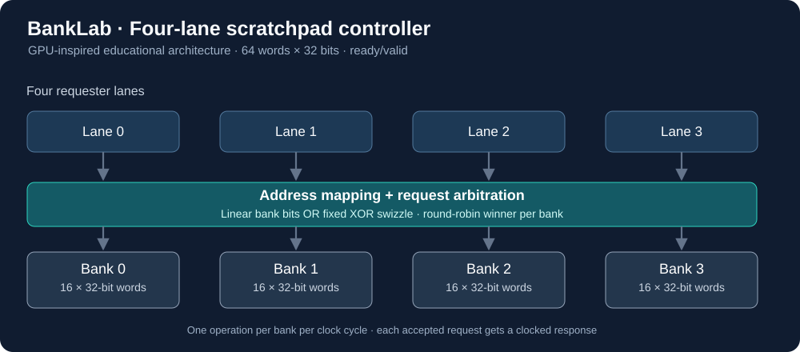
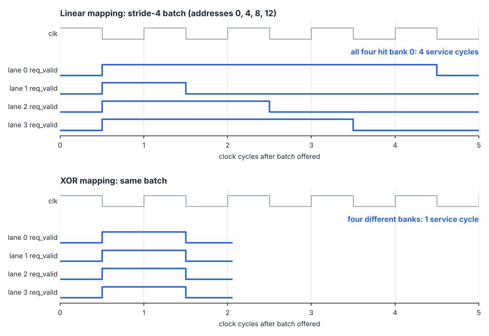

# BankLab — GPU-Inspired Banked Memory Controller

**Goal:** investigate how per-bank arbitration and address interleaving change concurrent memory-request throughput.



### The three variants

| Variant | `BANKED` | `HASHED` | What it demonstrates |
|---|---:|---:|---|
| Single-issue baseline | 0 | 0 | Global serial bottleneck, one request/cycle |
| Four-bank, linear map | 1 | 0 | Parallel arbitration, `bank = address[1:0]` |
| Four-bank, XOR map | 1 | 1 | Alternative mapping, `bank = address[1:0] XOR address[3:2]` |

`BANKED=0, HASHED=1` is also simulated as a fourth *validation* configuration.

## Results

Each benchmark has **40 groups of four simultaneous requests**. It measures **cycles spent servicing** requests within each group and **excludes idle clock cycles between batches**. Smaller is better.

| Access pattern | Serial | 4-bank linear | 4-bank XOR |
|---|---:|---:|---:|
| Contiguous | 4.00 | 1.00 | 1.00 |
| Stride 4 | 4.00 | 4.00 | 1.00 |
| Stride 8 | 4.00 | 4.00 | 2.00 |
| Mixed deterministic workload | 4.00 | 1.80 | 1.95 |


**Interpretation:** The XOR mapping dramatically helps stride-4 in this model, but is not universally faster. In the mixed pattern it slightly increases service time (1.95 vs 1.80 cycles), so the best mapping depends on the access pattern.

The RTL simulation reproduces every one of these per-batch cycle counts exactly; see [`results/RTL_RESULTS.md`](results/RTL_RESULTS.md).



## How to run

Requirements:

- [Icarus Verilog](https://steveicarus.github.io/iverilog/) 12.0 or newer (`iverilog` and `vvp` on your `PATH`)
  - Ubuntu/Debian: `sudo apt install iverilog`
  - macOS: `brew install icarus-verilog`
  - Windows: install from [bleyer.org/icarus](https://bleyer.org/icarus/) and add its `bin` folder to `PATH`
- Python 3.9 or newer (standard library only); `matplotlib` and `numpy` are optional and only needed to redraw the charts

Run everything (Python unit tests, model benchmarks, all four RTL configurations, and the model/RTL cross-check):

```bash
bash scripts/run_all.sh          # Linux / macOS
```

```powershell
./scripts/run_all.ps1            # Windows PowerShell
```

Optionally redraw the waveform figure from the generated VCD files:

```bash
python3 scripts/plot_waveform.py
```

## Project map

| Path | Contents |
|---|---|
| `rtl/banked_scratchpad.sv` | Four-lane, four-bank scratchpad with per-bank round-robin arbitration (`BANKED`, `HASHED` parameters) |
| `tb/tb_scratchpad.sv` | Self-checking testbench: golden memory, per-batch cycle counts, CSV and VCD output |
| `model/bank_model.py` | Python reference model of the same arbitration and memory behavior |
| `model/test_bank_model.py` | Unit tests for the reference model |
| `model/run_benchmarks.py` | Generates the model results tables, CSVs and chart |
| `model/verify_rtl.py` | Compares RTL simulation CSVs with the model, batch by batch |
| `scripts/run_all.sh`, `scripts/run_all.ps1` | One-command build, simulation and verification |
| `scripts/plot_waveform.py` | Draws `docs/waveform_stride4.png` from the VCD files |
| `results/` | Model and RTL results (Markdown, CSV, chart) |
| `docs/` | Architecture diagram and waveform figure |

## Scope

This is an educational design inspired by GPU shared-memory banking, not a model of any real GPU's memory controller. It has been verified in simulation only; see the limitations in [`results/RTL_RESULTS.md`](results/RTL_RESULTS.md#what-this-does-and-does-not-show).
