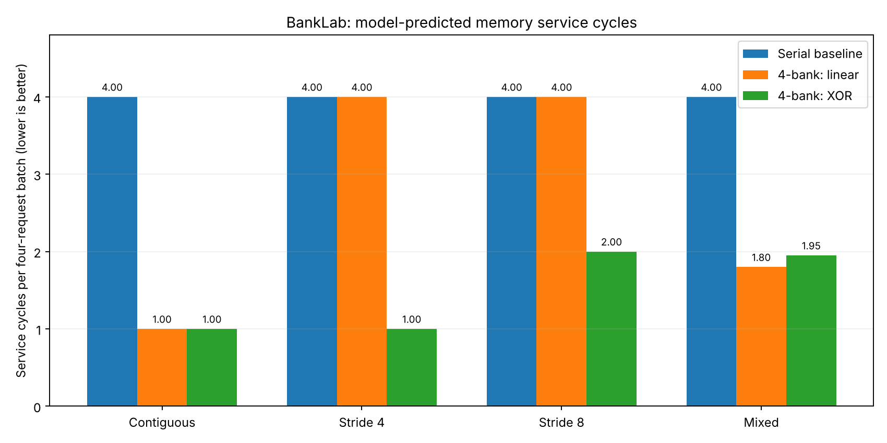

# Performance results — executable Python model

> These are deterministic model-predicted service cycles, **not** measured GPU
> performance. The RTL simulation reproduces them exactly (see RTL_RESULTS.md);
> to re-check, run `scripts/run_all.sh` (or `run_all.ps1`) with Icarus Verilog.

Each experiment contains 40 groups of four simultaneously offered requests.
The model excludes test-driver idle cycles between groups. Smaller is better.

| Access pattern | Serial baseline | 4-bank linear | 4-bank XOR |
|:--|--:|--:|--:|
| contiguous | 4.00 | 1.00 | 1.00 |
| stride4 | 4.00 | 4.00 | 1.00 |
| stride8 | 4.00 | 4.00 | 2.00 |
| mixed | 4.00 | 1.80 | 1.95 |

## Interpretation

- Different banks can be served in parallel, while competing requests to one bank serialize.
- XOR address mapping distributes stride-4 word accesses in this 4-bank model.
- The benefit depends on the access pattern: this does **not** universally improve throughput.
- This hardware supports distinct accesses, not same-word read broadcast/multicast.
- Address mapping is a hardware configuration parameter, **not** a runtime switch:
  changing mapping after writing memory would require moving stored contents.

